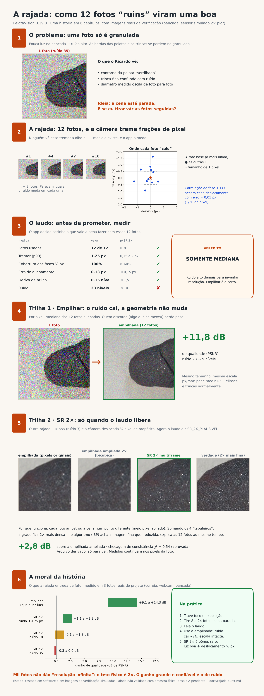

# Rajada (burst): empilhar várias fotos da mesma cena — 0.19.0

Pergunta de origem (20/11/2026): com a câmera imóvel, dá para aproveitar as pequenas vibrações entre
10, 20 ou 1000 fotos e montar uma imagem de resolução muito maior?

**Resposta medida:** o ganho grande e confiável é de **ruído**: a empilhada tem 9 a 14 dB a mais com
N = 12 a 24, sem mudar a grade nem a escala px/mm. O ganho de **resolução** tem teto físico de 2× e,
nas fotos do projeto, rendeu de −0,1 a +1,3 dB sobre a empilhada ampliada com ruído de 10 níveis.
Chegou a +1,2 a +2,8 dB só com ruído baixo (3 níveis) e deslocamento controlado. Por isso a SR 2× fica
desmarcada, só é liberada pelo laudo e nunca entra na medição.



*Figura gerada por `tools/burst_validate/figura_storytelling.py` a partir das saídas da verificação.*

Pesquisa e prompt de origem: `docs/pesquisa/rajada-burst-sr/`. Evidências desta versão:
`verification/burst-0.19.0/`.

## Estado (obrigatório citar o nível)

| Item | Estado |
|---|---|
| Laudo (Trilha 0), empilhada (Trilha 1), SR 2× (Trilha 2) no núcleo | implementado → **testado em software** (14 testes JUnit sintéticos) |
| Mesmas trilhas em fotos reais do repositório com rajada simulada | **demonstrado em imagem de verificação** (`verification/burst-0.19.0/`) |
| Rajada real de webcam/celular com amostra física (ensaio A) | **não validado** — pendente |
| Botão Rajada no Windows; 2+ fotos em "Abrir foto" no Android | implementado; **não compilado neste ambiente** (sem SDK Android/Gradle offline). Compilar e testar localmente |

## Como usar

**Windows:** painel de aquisição → **Rajada (várias fotos)…**
- **Capturar da câmera e analisar:** N quadros (4, 8, 16 ou 24) com intervalo de 40 a 2000 ms. Trave
  foco e exposição antes. O laudo informa se o ao vivo via a cena parada.
- **Escolher fotos e analisar…:** 2 a 24 arquivos do mesmo tamanho, em ordem de nome.
- **Abrir empilhada para análise:** a empilhada vira a foto da sessão. ROI, escala, segmentação e PDF
  funcionam como numa foto comum.
- **Salvar SR 2×…:** aparece só quando a SR foi pedida, liberada e aceita.

**Android:** **Abrir foto** e selecionar **2 ou mais** fotos da mesma cena no seletor. Com 1 foto, o
fluxo de sempre continua. A SR 2× fica desligada no Android nesta versão.

**Lote (ensaios):** `RAJADA.bat --saida PASTA FOTOS...|PASTA [--sr] [--roi x,y,w,h]`, que chama o
`BurstCli`. Ver `tools/burst_validate/README.md`.

## O laudo (Trilha 0, `BurstDiagnostics`)

Para cada quadro, o laudo mede:
- o deslocamento sub-pixel contra a base: correlação de fase em ½ resolução e refino por ECC de
  translação. A convenção é `quadro_k(p + d) = base(p)`;
- o erro interno de registro, pelas estimativas independentes nas duas metades do recorte:
  `rms(|dA − dB|)/2`;
- a deriva de brilho: mediana das diferenças em blocos 16×16;
- a nitidez, pela variância do Laplaciano;
- o ruído pelo método de Immerkær, medido no cinza (luma);
- o resíduo depois de alinhar, que indica cena em movimento.

A base é o quadro mais nítido entre os de brilho típico.

Motivos para rejeitar um quadro (chaves do JSON):
- `registro_falhou`
- `deslocamento_excessivo` (> 10% do lado do recorte)
- `registro_sem_pico`
- `deriva_brilho` (> 6 níveis)
- `movimento_nao_translacional` (as metades discordam > 1,5 px)
- `cena_em_movimento`

Veredito:

```
SR_2X_PLAUSIVEL  somente se  N usados >= 8
                   e tremor p90 entre 0,15 e 2,0 px
                   e cobertura da grade 2x >= 60%   (4 fases, célula com >= 2 quadros)
                   e erro interno de registro <= 0,15 px
                   e deriva de brilho p90 <= 1,5 nível
                   e ruído (luma) <= 10 níveis       (ensaio de 20/11: acima disso a SR perde)
                   e cena parada (LiveMotion quando há, resíduo sempre)
caso contrário     SOMENTE_MEDIANA, com os motivos na tela
menos de 2 usados  NADA_A_FAZER
```

Constantes nomeadas em `BurstDiagnostics` (ajustáveis, mas mude só com ensaio).

## Empilhada (Trilha 1, `BurstFuse`)

Por pixel, o consenso é a mediana do cinza entre os quadros alinhados (cúbica, borda replicada).
Cada quadro tem peso `confiança_do_registro × exp(−½ (r / 2,5σ)²)`, e a saída é a média ponderada das
cores. Um objeto que se moveu em um quadro perde peso naquele pixel em vez de deixar fantasma.

- Mesma grade de pixels da base: coordenadas e escala px/mm não mudam.
- A empilhada **pode** ser medida (`used_for_measurement = true`, `measurement_source = burst_median_on_base_grid`).
- O processamento é em faixas de linhas. Quem segura a memória são as N fotos decodificadas.

## SR 2× (Trilha 2, `BurstSr`)

Modelo direto `y_k = D B S_k(x) + n`: translação sub-pixel, integração do pixel (caixa de 2 px HR) e
decimação. A borda é replicada. Etapas:

1. O ponto de partida é a empilhada ampliada por bicúbica (Irani–Peleg). Sem ela, o drizzle (convolução
   normalizada).
2. IBP com 6 a 12 iterações em duas fases:
   - metade sem máscara;
   - depois máscara de robustez (`exp(−½ (r/3σ)²)`) e suavidade só nas áreas planas da estimativa
     (peso `exp(−(|∇x|/τ)²)`, `τ = 4σ+1`, `μ = 0,5·N/4`).
   - Passo: `1,2 / (λ_max + 8μ)`, com λ_max por iteração de potência.
3. **Gates:** adjunta exata (`|<Ax,r> − <x,Aᵀr>|` relativo ≤ 1e-9; medido ~1e-14) e
   `χ² = média(r²)/σ² ≤ 2,5` sobre todas as amostras. Registro errado, cena que mexeu ou câmera fora do
   modelo reprovam a SR, e fica a mediana.
4. O recorte é de até 512×512 px da foto, centrado na região de registro e recuado do maior
   deslocamento. A saída é 2× (até 1024²), com `px/mm = 2 × px/mm da foto`, registrada no JSON.
   **Arquivo derivado: nunca é medida.** Elipses e trincas continuam nos pixels da foto.

Por que a suavidade: a caixa de 2 px HR tem resposta zero no Nyquist da grade HR. O ruído ali não
aparece nos dados e o IBP sem regularização o amplifica. Na foto de correia, com ruído de 10 níveis, a
SR foi de 34,2 dB (`μ = 0,05`) para 38,9 dB (`μ = 0,3 a 1`).

## O que foi medido (resumo de `verification/burst-0.19.0/`)

Para cada caso, um recorte de 512² de uma foto real faz o papel de verdade. Os 12 ou 24 quadros
simulam um sensor 2× pior: verdade deslocada, integrada em 2×2, mais ruído gaussiano. Todos os números
estão em PSNR contra a verdade.

| Foto | Ruído / tremor | Empilhada vs 1 quadro | SR 2× vs empilhada ampliada |
|---|---|---|---|
| correia, webcam, bancada | 10 / tripé | **+9,1 a +10,7 dB** | (SR não liberada: sem tremor) |
| correia, webcam, bancada | 35 / mão 0,5 px | **+9,2 a +11,8 dB** | (não liberada: ruído) |
| correia, webcam, bancada | 10 / mão 0,5 px | +9,5 a +11,4 dB | +0,02 / +0,26 / +1,12 dB |
| correia, webcam, bancada | 10 / grade ½ px | +9,5 a +11,6 dB | −0,14 / +0,09 / +1,30 dB |
| correia, webcam, bancada | 3 / grade ½ px | +3,7 a +8,8 dB | **+1,15 / +2,18 / +2,79 dB** |
| correia, webcam, bancada | 35 / grade (SR forçada) | +9,3 a +12,0 dB | −0,32 / −0,02 / −0,13 dB |
| correia, webcam, bancada | 10 / mão 1,5 px, N=24 | **+10,9 a +14,3 dB** | (não liberada: tremor p90 > 2 px) |

- Erro dos offsets estimados: p90 de 0,02 a 0,10 px.
- O laudo liberou a SR exatamente nos casos em que ela não perdeu de forma relevante. No único caso
  liberado com perda (correia, grade, ruído 10), a perda foi de 0,14 dB.
- Tempo, em Java com 2 núcleos de CPU:
  - 8 quadros 1920×1080, laudo + empilhada: 3,9 s;
  - 12 quadros 256², laudo + empilhada: ~0,5 s; com SR 2× colorida (4 reconstruções): ~4,5 s.
  - O recorte máximo de 512² deve levar ~4× isso.

**Leitura operacional:**
- A rajada vale pelo ruído.
- A SR 2× só compensa com ruído baixo, por exposição longa ou boa luz.
- O deslocamento controlado (calço ou parafuso de ½ px) garante as fases sem depender da sorte.
- Câmera em tripé sem tremor **não** dá SR. Isso é o resultado certo.

## O que NÃO fazer
- Não prometer resolução "muito superior" a partir de 10, 20 ou 1000 fotos. Mil fotos dão ~30 dB de
  ruído a menos numa cena parada e nada de resolução além de 2×.
- Não medir trincas ou elipses em pixels reconstruídos.
- Não encadear FSRCNN depois da SR para "chegar a 4×".
- Não fazer rajada com exposição, foco ou balanço de branco variando. O laudo rejeita esses quadros.
- Correia em movimento é vídeo com objeto móvel: a fusão por quadro **engorda** a pelota. A Trilha 4
  (SR por pelota) segue como pesquisa e não foi implementada.
- Não escrever "validado" sem o ensaio A com amostra física.

## Pendências (próximas versões)
1. **Ensaio A** (repetibilidade): 20 rajadas da mesma amostra em 3 montagens (tripé, mão apoiada, suporte
   na correia), comparadas com paquímetro em ≥ 30 pelotas ou com peneira. Critério para manter a
   empilhada como padrão de rajada: −20% de erro de diâmetro **ou** −30% de CV de D50, sem aumentar as
   inconclusivas. Roteiro em `tools/burst_validate/README.md`.
2. **Ensaio B** (sensibilidade a tremor), incluindo o "pixel shift feito em casa" com calço.
3. Android com CameraX/Camera2: rajada direto da câmera com AE/AWB/AF travados, e SR 2× depois de medir o
   custo no aparelho.
4. Rajada do ao vivo no Windows reaproveitando o `LiveStabilizer` (quadros já parados).
5. `Mats.MAX_ANALYSIS_SIDE = 3000` continua descartando resolução em fotos maiores. A rajada trabalha
   antes desse corte só no `BurstCli`. Rever o corte antes de investir mais em SR.
6. Trilha 3 (rede neural refinando a IBP) e Trilha 4 (correia, SR por pelota): só depois do ensaio A.
